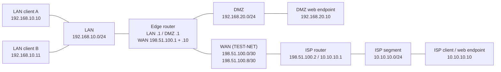

# QEMU/KVM Infrastructure Lab

**English** | [Русский](README.ru.md)

A personal Linux networking lab with six Debian virtual machines, LAN/DMZ/WAN/ISP segmentation, routing, NAT and a forwarding firewall. This repository documents verified learning work: inventory, service hardening, configuration recovery planning and checks after guest reboots.

**Skills shown:** Linux routing, NAT and firewalling (iptables-nft / nftables), libvirt/KVM, systemd service hardening, Ansible, SSH policy, and writing down what was and was not tested.

**Verified on 7 November 2026:** six guest reboot checks PASS; 33 final network expectation checks PASS, 0 FAIL. These are historical results from the final validation, not live monitoring or a new audit.

## Learning environment

Two LAN clients, a DMZ HTTP endpoint, an edge router, an ISP router and an ISP client simulate a small routed environment. Three auxiliary VMs were inventoried separately while powered off; they were excluded from the main lab and final live tests. All public node labels are role aliases, not actual VM names or hostnames.

## Confirmed technologies

CachyOS Linux host; QEMU 11.1.3 / KVM; libvirt 12.9.0; six Debian 13.7 guests; systemd; ifupdown; static IPv4 routing; iptables-nft / nftables; OpenSSH; QEMU guest agent; Python `http.server`. Host-side dnsmasq was observed; guest DNS is not configured. UFW was observed on the host; its complete live ruleset was not independently validated.

## Architecture

The edge router connects LAN, DMZ and WAN. The ISP router connects WAN to the simulated ISP segment and has no default route to the Internet. Guest routing provides the intended L3 paths over libvirt L2 segments. WAN addresses below use documentation-only TEST-NET; the working lab was not renumbered.

LAN uses `192.168.10.0/24`, DMZ `192.168.20.0/24`, and ISP `10.10.10.0/24`. The published DMZ address is represented as `198.51.100.10`. See [architecture](docs/en/architecture.md) for NAT, routing and permitted paths.

## Test results

| Verification | Confirmed result |
|---|---|
| Six individual guest reboots | Addresses, routes, forwarding and required services restored |
| Final traffic matrix | 33 PASS, including expected blocked connections with positive controls |
| LAN MASQUERADE and WAN DNAT | HTTP 200, counter changes and translated LAN source observed |
| Firewall persistence | Saved/runtime rules matched; FORWARD DROP; early startup verified |
| HTTP services | Unprivileged execution, read-only web content, restart and reboot checked |
| Synthetic HTTP escape checks | Six 404 responses; non-secret canary undisclosed |

[Validation and the full 33-check matrix](docs/en/validation.md) distinguish PASS from NOT TESTED. A preserved outbound DMZ SNAT rule was inspected but not exercised by an outbound flow.

## Reproducible build

The [`infra/`](infra/README.md) directory rebuilds the lab: libvirt networks and a `--dry-run`-capable creation script, Ansible roles for addressing, the edge firewall, the web endpoints, optional TLS and SSH hardening, a read-only traffic-matrix playbook and a native nftables example. **Status:** written from this documentation, linted and partly tested in isolation (rule syntax, SSH policy against a throwaway daemon), but **not yet run end to end on fresh guests**; see [the status table](docs/en/infrastructure-as-code.md#status-and-honesty-note).

## Security

Unsafe root HTTP processes were replaced with dedicated unprivileged systemd services. Firewall startup now precedes interface activation; web content is root-owned and served read-only. An [SSH authentication policy with verification tooling](docs/en/ssh-hardening.md) is provided but has not yet been applied to the original guests. Original operational change/reboot scripts and raw evidence are excluded; the reference code in `infra/` is new. See [security and sanitization](docs/en/security.md).

## Known limitations

This is a learning lab, built with AI assistance (see the [case study](docs/en/portfolio-case.md)); it is not commercial delivery. In the documented lab HTTP has no TLS (an optional TLS role exists in `infra/` but has not been run) and guests use IP addresses without DNS. Router INPUT/OUTPUT remain ACCEPT, so forwarding restrictions do not secure the management plane (a `strict` mode exists in `infra/`, untested on guests). SSH authentication of the original guests, exhaustive IPv6/alternative-path isolation, external connectivity, host reboot and full VM restoration were not tested. The reproducible build has not been run end to end. Configuration recovery copies are not independent off-host system backups. Optional AF_VSOCK SSH generator errors remain documented despite zero failed units. Only one reboot cycle per main guest was verified.

## Documentation

| Topic | English | Русский |
|---|---|---|
| Network and inventory | [Architecture](docs/en/architecture.md) | [Архитектура](docs/ru/architecture.md) |
| Tests and reboot verification | [Validation](docs/en/validation.md) | [Проверки](docs/ru/validation.md) |
| Security, limits and publication | [Security](docs/en/security.md) | [Безопасность](docs/ru/security.md) |
| Rebuilding the lab, TLS option | [Infrastructure as code](docs/en/infrastructure-as-code.md) | [Инфраструктура как код](docs/ru/infrastructure-as-code.md) |
| SSH policy and checks | [SSH hardening](docs/en/ssh-hardening.md) | [Защита SSH](docs/ru/ssh-hardening.md) |
| Work and portfolio description | [Case study](docs/en/portfolio-case.md) | [Описание кейса](docs/ru/portfolio-case.md) |

Reusable [Mermaid source](diagrams/network-topology.mmd). Before any publication, run `python3 scripts/check_public.py` and manually inspect every file. The checker uses only the Python standard library and does not contact the lab or any network.

## License

[MIT](LICENSE). Documentation and code are provided as is, without warranty; do not expose a running lab to the Internet.
