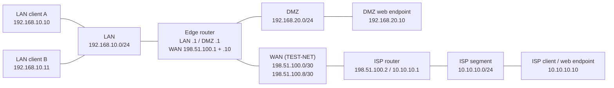

# QEMU/KVM Infrastructure Lab

[English](README.md) | **Русский**

Личная учебная лаборатория Linux: шесть Debian-ВМ, сегменты LAN/DMZ/WAN/ISP, маршрутизация, NAT и firewall транзитного трафика. Репозиторий описывает подтверждённую работу: инвентаризацию, усиление защиты служб, подготовку восстановления конфигураций и проверки после перезагрузки гостей.

**Подтверждено 7 ноября 2026 года:** шесть проверок перезагрузки PASS; 33 итоговые сетевые проверки PASS, 0 FAIL. Это сохранённые результаты итоговой проверки, а не мониторинг или новый аудит.

## Учебная среда

Два LAN-клиента, HTTP-узел DMZ, пограничный маршрутизатор, маршрутизатор ISP и клиент ISP моделируют небольшую маршрутизируемую сеть. Ещё три вспомогательные ВМ инвентаризированы отдельно в выключенном состоянии; в основную лабораторию и итоговые live-тесты они не входили. Публичные обозначения узлов — условные роли, а не реальные имена ВМ или hostname.

## Подтверждённые технологии

Хост CachyOS Linux; QEMU 11.1.3 / KVM; libvirt 12.9.0; шесть гостей Debian 13.7; systemd; ifupdown; статическая IPv4-маршрутизация; iptables-nft / nftables; OpenSSH; QEMU guest agent; Python `http.server`. На хосте наблюдался dnsmasq; DNS в гостях не настроен. На хосте наблюдался UFW; полный набор его действующих правил независимо не проверялся.

## Архитектура

Пограничный маршрутизатор связывает LAN, DMZ и WAN. Маршрутизатор ISP соединяет WAN с учебным ISP-сегментом и не имеет default route в Интернет. Гостевые маршрутизаторы обеспечивают предусмотренные L3-пути поверх L2-сегментов libvirt. WAN-адреса на схеме заменены на документальные TEST-NET; рабочая адресация лаборатории не менялась.

LAN: `192.168.10.0/24`, DMZ: `192.168.20.0/24`, ISP: `10.10.10.0/24`. Опубликованный адрес DMZ обозначен как `198.51.100.10`. NAT, маршруты и разрешённые потоки описаны в [архитектуре](docs/ru/architecture.md).

## Результаты тестирования

| Проверка | Подтверждённый результат |
|---|---|
| Поочерёдная перезагрузка шести гостей | Адреса, маршруты, forwarding и необходимые службы восстановились |
| Итоговая сетевая матрица | 33 PASS, включая ожидаемые запреты с положительными контролями |
| LAN MASQUERADE и WAN DNAT | HTTP 200, рост счётчиков, наблюдение преобразованного LAN source |
| Сохранение firewall | Сохранённые и действующие правила совпали; FORWARD DROP; ранний запуск проверен |
| HTTP-службы | Непривилегированный процесс, read-only контент, проверки restart и reboot |
| Искусственные HTTP escape-пробы | Шесть ответов 404; несекретный canary не раскрыт |

[Полная матрица из 33 проверок](docs/ru/validation.md) разделяет PASS и NOT TESTED. Сохранённое правило исходящего DMZ SNAT проверено по конфигурации, но отдельным исходящим потоком не испытано.

## Безопасность

Небезопасные root HTTP-процессы заменены выделенными непривилегированными systemd-службами. Firewall загружается до активации интерфейсов; веб-контент принадлежит root и доступен службе только для чтения. В репозитории находятся документация и локальная проверка публикации; скрипты изменения/перезагрузки и сырые доказательства исключены. Подробнее: [безопасность и очистка](docs/ru/security.md).

## Известные ограничения

Это учебная лаборатория. HTTP работает без TLS; гости используют IP без DNS. INPUT/OUTPUT маршрутизатора остаются ACCEPT: транзитный firewall не защищает management plane. Не проверялись SSH-аутентификация, полная IPv6/альтернативная изоляция, внешняя связь, перезагрузка хоста и полное восстановление ВМ. Конфигурационные копии не заменяют независимый off-host backup системы. Сохраняются ошибки необязательного AF_VSOCK SSH generator при нуле failed units. Для каждого основного гостя подтверждён один reboot-цикл.

## Документация

| Тема | English | Русский |
|---|---|---|
| Сеть и состав | [Architecture](docs/en/architecture.md) | [Архитектура](docs/ru/architecture.md) |
| Тесты и перезагрузка | [Validation](docs/en/validation.md) | [Проверки](docs/ru/validation.md) |
| Безопасность, ограничения, публикация | [Security](docs/en/security.md) | [Безопасность](docs/ru/security.md) |
| Выполненная работа и портфолио | [Case study](docs/en/portfolio-case.md) | [Описание кейса](docs/ru/portfolio-case.md) |

[Исходник Mermaid](diagrams/network-topology.mmd). Перед публикацией выполните `python3 scripts/check_public.py` и прочитайте каждый файл вручную. Скрипт использует только стандартную библиотеку Python и не обращается к лаборатории или сети.
